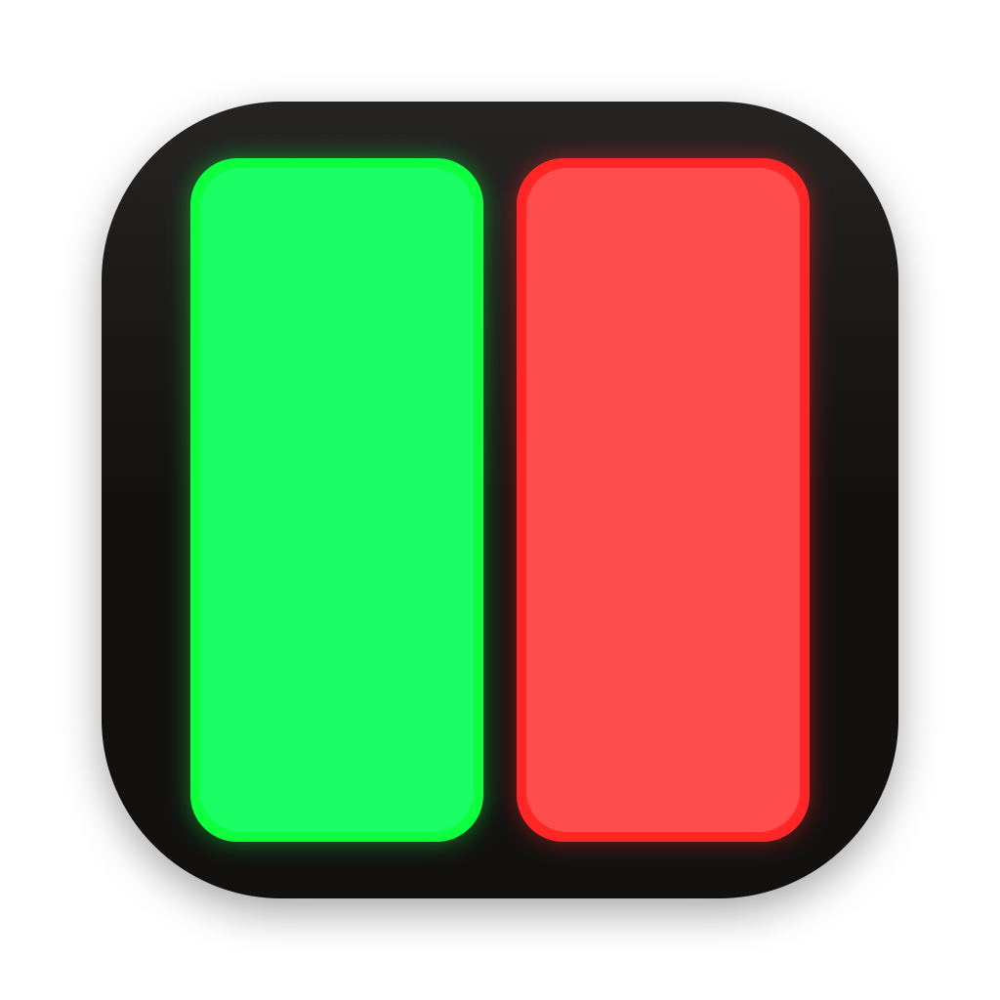
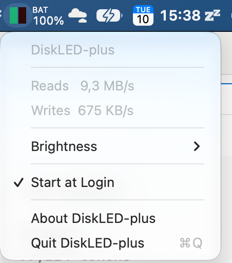
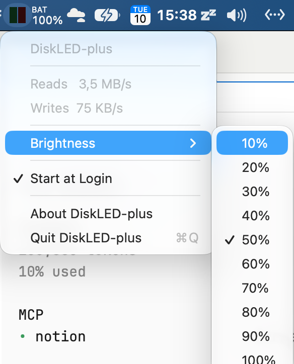

# DiskLED-plus

Every I/O gets its own blink.
A macOS menu bar app in the spirit of Helge Klein's DiskLED: not a thermometer, not a
graph — a live LED. One square made of two vertical rectangles: **left bright green
for reads, right red for writes**. Sampled at 30 ms (~33×/s), so every tiny read or
write becomes its own instant flash the way 80s-era physical HDD LEDs did — and
sustained load reads as steadily ON — never lazy, rounded-up, averaged summaries like
today's router LEDs do.

Fully open source (MIT), builds in one command with SwiftPM, no admin rights needed.

## What it looks like

The app icon — same dark plate, same two bars, both lit (also what the About
dialog shows):

<div align="center">
  
</div>

The status item is a 16×16 pt square split into two vertical rectangles —
**left green = reads, right red = writes** — lit for every tick that actually
moved data, near-dark when a tick had none:

| Off | Reads | Writes | Both |
|-----|-------|--------|------|
|  |  |  |  |

Clicking it opens a menu with the live B/s readout taken over a display-only
~1 s window, a ten-step **Brightness** setting, and **Start at Login**:

| Menu | Brightness |
|------|------------|
|  |  |

## Install

Get it from [Releases](https://github.com/Marcus1571/diskled-plus/releases/latest) —
download `DiskLED-plus-<version>.dmg`, drag the app to **/Applications**. The DMG
is Developer ID–signed and notarized by Apple, so Gatekeeper opens it silently;
the app updates itself (Sparkle checks at startup and weekly; updates install
automatically, or force one via **Check for Updates…** in the menu). Enabling
**Start at Login** in the menu bar menu is all the setup there is.

Building the DMG yourself: `scripts/make-dmg.sh` → notarization requires the
project's Apple credentials (see KB.md §Packaging and §Updates).

## Build and run

```
git clone git@github.com:Marcus1571/diskled-plus.git ~/src/diskled-plus
cd ~/src/diskled-plus && swift build -c release
.build/release/DiskLEDPlus
```

For everyday use, package it as a real `.app` with
[scripts/make-app.sh](scripts/make-app.sh) and copy it to `/Applications`
(see [KB.md §Packaging](KB.md#packaging-app-bundle)) — then flip **Start at
Login** in the menu bar menu and it survives reboots on its own.

## What it is NOT

It is not iStat Menus, MenuMeters, or Stats — those are excellent meters, but they
sample on seconds-scale cadence and present numbers or graphs. DiskLED-plus samples
at 33 Hz and shows *every* tick the disk actually moved data, exactly as deeply
explained in [findings.md](findings.md#diskleds-magic-number-is-30-ms-verified-in-upstream-source).

For the full architecture, blink model, and build/run reference, see
[KB.md](KB.md#what-the-app-does). Idea credit: [DiskLED](https://helgeklein.com/free-tools/diskled/)
by Helge Klein (Windows, freeware) — no code or assets copied.
